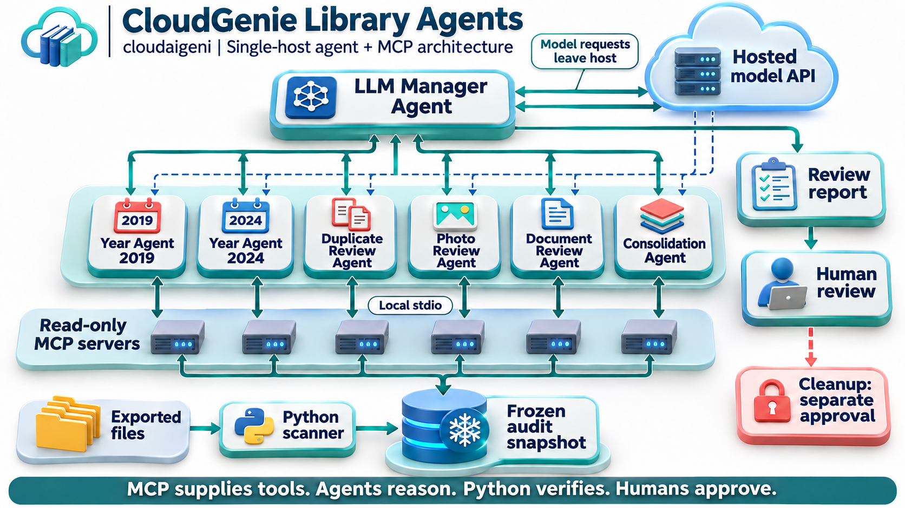

# CloudGenie Library Agents



Conceptual architecture, not a live-run status display. The illustrated years
match the demo; real year agents are created from the audit catalog.
See the [3D design gallery and tool-call walkthrough](docs/designs/README.md).

## Real LLM Agents and MCP on Ubuntu

The optional `agents` extra adds an OpenAI Agents SDK manager, independent year
subagents, global duplicate/document/consolidation reviewers, and a real read-only
MCP server. See [cloudaigeni deployment and learning guide](docs/CLOUDAIGENI-DEPLOYMENT.md)
and [agent architecture](docs/AGENT-ARCHITECTURE.md). Python 3.11+ is required for
this extra. Model access and explicit data-disclosure consent are required for
LLM review; `--probe` tests MCP without calling a model.

The original PDF guide and diagrams describe the deterministic v1 engine below;
the linked Markdown documents describe the new agent layer. No agent can delete
files. This is a single-host deployment, not a distributed machine cluster.

## Deterministic Scan Engine

A Python coordinator and specialist workers for organizing a personal document and photo library. Run it on Windows, WSL Ubuntu, Linux, or a container with access to your exported files. The default scan is read-only and works without an LLM, MCP, Google credentials, or a paid API.

The workers inventory each year, extract document content, compare duplicate evidence across all years, and assemble subject reading packs. Cleanup is a separate command sequence: review an exact-byte plan, quarantine approved copies, then optionally approve a separate permanent purge.

## What is included

- One coordinator and inventory worker; dynamically scheduled year and format specialist jobs.
- Text, PDF, PPTX, DOCX and XLSX extraction, including slide notes, document tables, formula strings and document hyperlinks where supported.
- Complete SHA-256 file hashing, decoded-image matches and perceptual photo candidates.
- Global matching across years and multiple source folders.
- Takeout JSON sidecar association, capture-year inference and recognition of repeated export representations of a single Photos item.
- Topic suggestions using TF-IDF and MiniBatchKMeans, followed by combined Markdown reading packs with per-block source references.
- Optional image OCR and optional summaries through a local Ollama service.
- SQLite cache, JSON event history, CSV inventory, JSON evidence and explicit extraction errors.
- Reviewed quarantine, restore, and separately approved permanent purge of local copies.
- A Dockerfile, disposable demo, regression tests, illustrated architecture and a printable operations guide.

These are task-specific software agents with deterministic permissions and scheduling. They are not independent LLM conversations and are not a multi-machine cluster. The optional local model writes an unverified summary only; it cannot call tools, change an approval, or delete a file.

## Install on WSL Ubuntu

Use Python 3.10 or newer. From this app directory:

```bash
python3 -m venv .venv
source .venv/bin/activate
python -m pip install -e '.[analysis]'
python -m library_agents doctor
```

On Ubuntu, install `python3-venv` if the venv command reports that it is missing. Windows drives are available under `/mnt/c`, `/mnt/d`, and so on. Extract every Takeout ZIP part into the same independent export folder before scanning; archive contents are not traversed by this app.

## Install on Windows PowerShell

```powershell
py -3 -m venv .venv
.\.venv\Scripts\python.exe -m pip install -e '.[analysis]'
.\.venv\Scripts\python.exe -m library_agents doctor
```

The commands below use `python`. In PowerShell, substitute `.\.venv\Scripts\python.exe` unless that virtual environment is already activated.

## Try disposable demo data first

```bash
python examples/create_demo.py demo-data
python -m library_agents scan --source demo-data --output runs/demo
```

The demo intentionally contains exact duplicate text and image files, related documents, and an image with identical pixels but different metadata. Existing demo directories are never overwritten. The example generator also creates a PDF when ReportLab is installed. Optional fixture formats are skipped if their packages are unavailable.

## Scan your exports

```bash
python -m library_agents scan \
  --source '/mnt/d/GoogleExport/Takeout/Google Photos' \
  --source '/mnt/d/GoogleExport/Takeout/Drive' \
  --output '/mnt/d/LibraryAudit/run-001' \
  --workers 4
```

PowerShell equivalent:

```powershell
python -m library_agents scan --source 'D:\GoogleExport\Takeout\Google Photos' --source 'D:\GoogleExport\Takeout\Drive' --output 'D:\LibraryAudit\run-001' --workers 4
```

Sources and run output must be separate directories; neither may contain the other. Symlinks and directory junctions are skipped or rejected. Do not edit source files while an audit or cleanup is running. Prefer an independent export folder rather than a live Drive or OneDrive sync folder, where local cleanup could propagate through that sync service.

To limit an investigation:

```bash
python -m library_agents scan --source /data/export --output /data/audit-2024 --year 2024 --extensions pdf,pptx,docx,txt,jpg,png
```

A filtered scan cannot establish whole-library uniqueness. Excluded items and filter reasons are recorded. Sidecar dates take priority, then image EXIF dates, a year in the filename or folder, then filesystem modification time in UTC. Modification time can be the download date. A named year worker owns one year and one specialist queue; the duplicate and subject stages still compare the entire selected corpus.

You may also edit `config.example.json` for your machine and run:

```bash
python -m library_agents scan --config config.example.json
```

Command-line values override corresponding config settings. Config source paths are interpreted relative to the working directory, not the config file. Never put account passwords or tokens in this configuration; no cloud authentication is used.

## Inspect the outputs

| File | Purpose |
| --- | --- |
| `REPORT.md` | Overview, coverage, limitations and next steps |
| `summary.json` | Counts, years, categories, cache use and agent timings |
| `catalog.json` | Authoritative file IDs, paths, hashes, dates, sidecars and extracted text |
| `inventory.csv` | A sortable per-file inventory |
| `duplicates.json` | Exact bytes, export repeats, matching pixels, matching text and similar photos |
| `topics.json` | Suggested subjects and their source IDs |
| `consolidated/<run-id>/` | Current run's combined topic packs and source maps |
| `urls.csv` | Links found in extracted document content and supported relationships |
| `cloud-review.csv` | Original Photos links where available; every decision starts pending |
| `events.jsonl` | Worker scheduling and completion events |
| `cache.sqlite3` | Local extraction cache for resumable scans |
| `status.json` | Running or completed state |

Outputs can contain private extracted text and file names. Store them privately. The catalog's content hash binds each approval plan to that exact inventory. Rescanning replaces the catalog and invalidates earlier plans; earlier topic packs live in their own run-ID directory. Do not rescan a run directory after quarantining files if you need that catalog for restoration. Start a new run directory for a new inventory instead.

## Understand the evidence

| Evidence | Meaning | Cleanup eligibility |
| --- | --- | --- |
| Complete SHA-256 and size match | Same file bytes, revalidated before mutation | May be proposed; explicit approval still required |
| Same hash and same Photos cloud URL | Repeated representation of one item in export folders | Excluded from generated cleanup plans |
| Same decoded pixels, different bytes | Image data appears equal but metadata or encoding differs | Review only |
| Perceptual hash near-match | Visually similar image candidate | Review only |
| Same normalized extracted text | Text agrees; media, notes, signatures or other data may differ | Review only |
| Same suggested topic | Related content worth reading together | Never a deletion reason |

Hardlink aliases do not become cleanup actions. GIFs, multipage TIFFs and other multiframe images get complete byte comparisons only. Low-information images skip perceptual comparison. Image pHash candidates use up to five nearest neighbors and are not exhaustive, particularly for crops. Exact matching is global and has no similarity-item cap; similarity and subject stages are explicitly skipped above the configured limit.

## Consolidate related content

The subject worker suggests groups from extracted document text. The consolidation worker produces one reading pack per suggested topic, collapses repeated text blocks, and lists every contributing file ID and page, slide or block reference. It retains all originals. This is a study and navigation artifact, not a lossless merged PDF, PowerPoint or workbook.

Do not delete original documents merely because a pack exists: it may omit figures, editable elements, comments, tracked revisions, spreadsheet formatting, embedded objects or layout. Truncated and failed extractions remain marked in the catalog. Topic grouping is statistical and can put unrelated content together; review the group and source map before relying on it.

For an optional local-model summary, first install and run Ollama with a model of your choice. Then supply its installed model name:

```bash
python -m library_agents scan --source /data/export --output /data/audit-with-summary --llm-model YOUR_INSTALLED_MODEL
```

Only this explicit flag sends source text to `http://127.0.0.1:11434/api/chat`. Each request uses at most the first 50,000 characters of a pack. The response is written to a separate `AI-SUMMARY.md` file and labeled unverified. No cloud model or model download is configured by this project. In a container, loopback refers to that container; the optional model must be reachable there through an explicitly configured environment, otherwise the app writes an error artifact and retains the source pack.

Optional OCR applies to image files only. Install the OCR extra and the Tesseract executable separately, then use `--ocr`. Scanned PDFs are marked for OCR; this version does not render PDF pages for OCR.

```bash
python -m pip install -e '.[analysis,ocr]'
python -m library_agents scan --source /data/export --output /data/audit-ocr --ocr
```

## Review and quarantine local duplicates

Generate an unapproved plan only after reviewing the audit:

```bash
python -m library_agents plan --run /data/audit --output /data/quarantine-plan.json
```

Review each keeper and proposed removal. Change only the selected actions' `approved` booleans from `false` to `true`. Keep file IDs, displayed paths, hashes, run ID and catalog hash unchanged. Unapproved actions are ignored.

Always preview the reviewed plan:

```bash
python -m library_agents apply --run /data/audit --plan /data/quarantine-plan.json --quarantine /data/quarantine
```

To execute that reviewed plan, add `--execute`:

```bash
python -m library_agents apply --run /data/audit --plan /data/quarantine-plan.json --quarantine /data/quarantine --execute
```

The worker preflights every approved pair and rehashes retained copies. It creates and verifies a separate quarantine copy, revalidates the source and retained copy, then removes the approved local source. A journal records each operation. A changed file, edited plan, missing keeper, hardlink alias or conflicting destination blocks the operation. Quarantine must be outside every source and the run folder. Quarantine initially retains the bytes, so it does not itself reclaim all local storage.

The plan cannot schedule any retained copy for removal. Execution is sequential after concurrent analysis. Keep the machine and source files stable during execution. Operations are journaled per file, not a whole-library filesystem transaction; an I/O failure can leave earlier operations completed, with verified backups available for restoration.

## Restore quarantined copies

Preview first, then execute when appropriate:

```bash
python -m library_agents restore --run /data/audit --quarantine /data/quarantine
python -m library_agents restore --run /data/audit --quarantine /data/quarantine --execute
```

Restore never overwrites an existing different file. It verifies the backup hash and retains the quarantine backup after restoration. Keep the original run's catalog and quarantine journal together. A permanently purged copy cannot be restored by this tool.

## Optional permanent purge

Permanent deletion is deliberately separate from quarantine. Create another plan:

```bash
python -m library_agents purge-plan --run /data/audit --quarantine /data/quarantine --output /data/purge-plan.json
```

Review it independently and approve only selected actions. Preview:

```bash
python -m library_agents purge --run /data/audit --quarantine /data/quarantine --plan /data/purge-plan.json
```

Only an explicit permanent-deletion command removes verified quarantine copies:

```bash
python -m library_agents purge --run /data/audit --quarantine /data/quarantine --plan /data/purge-plan.json --execute --confirm PERMANENTLY_DELETE_APPROVED_QUARANTINE
```

The purge worker checks that each copy is journaled as quarantined and that its retained original still matches the full hash. It never purges by similar appearance, same text, or a topic suggestion. The implementation does not defend against an administrator maliciously replacing files during the final filesystem checks; do not run concurrent writers against the library.

## Run in Docker or a sandbox

Build from this app directory:

```bash
docker build -t library-agents .
mkdir -p /data/library-audit
docker run --rm --network none --user "$(id -u):$(id -g)" \
  -v /data/export:/input:ro \
  -v /data/library-audit:/output \
  library-agents scan --source /input --output /output/run-001
```

The image installs analysis dependencies during build; the scan itself needs no network. The container runs as a non-root user, with `--user` matching your Ubuntu user so bind-mounted output remains writable. Adjust host paths to your machine. A generic sandbox must similarly receive the input folder and a persistent output mount.

Catalog paths belong to the environment that created them. `/input/...` inside a container is not a Windows path. Run later cleanup or restore in the same path namespace, or create a fresh audit on the host where you intend to execute it. Audit containers should retain read-only source mounts; do not grant write access merely to test the analysis.

## Google Photos and MCP

MCP is not required. Python workers directly read the local files they are authorized to inspect. MCP can later expose selected reports or explicit tools to an assistant, but it does not add data permissions, bypass Google's API restrictions, or make deletion reliable.

Google's Photos Library API is restricted to app-created media. It cannot provide this app a complete inventory of a pre-existing personal library. This implementation consumes your Takeout export and produces original-cloud review links when the sidecars supply them. It does not scrape private Photos endpoints, use browser cookies, authenticate to Google, or delete cloud items.

Deleting a local export copy does not delete the Google Photos original or free its cloud quota. Conversely, a repeated album representation can correspond to only one cloud item. Photos cleanup must remain a separate, reviewed cloud operation with confirmed item identities and account context.

An optional future MCP adapter should expose read-only `get_status`, `get_summary` and `list_review_candidates` first. Keep source roots configured by the operator, avoid arbitrary path tools, and do not expose permanent purge as an automatically callable agent tool. That adapter is an architectural extension, not included executable server code.

## Operational limits and recovery

- This version schedules local threads. It does not distribute work to remote machines, use a message broker, or provide an interactive web dashboard.
- The first run hashes every selected file in full and therefore reads the entire selected byte volume. Start with 2-4 workers on a laptop; additional concurrency may slow a single disk.
- All selected file records and extracted text are held in memory. Default extraction is capped at 500,000 characters per document. For large corpora, lower that cap and work in verified batches; global cross-batch duplicate aggregation is not included.
- Default similarity limit is 10,000 eligible items per modality. Nearest-neighbor comparison is batched but still has substantial pairwise compute cost. Increase the limit only after measuring on a subset.
- The cache key includes path, size, modification and change times, filesystem identity, settings and sidecar content. Cleanup always reads original bytes again, rather than trusting cache entries.
- A run folder permits one operation at a time. If a process is interrupted, check that it has stopped before removing a stale `.operation.lock` file. Rerun a scan to reuse successfully cached tasks; completed per-file quarantine operations can be recognized from verified backups on reapplication.
- Optional package failures and unsupported formats are recorded. Empty extraction is never treated as duplicate evidence.
- Old binary Office formats, native cloud shortcut stubs, scanned PDFs, video visual similarity and OCR-based photo classification need additional converters or future workers. Ordinary full-file hashes still cover readable unsupported files.
- This is an audit tool, not a malware sandbox. Use an isolated environment for untrusted documents and keep parser dependencies updated.

## Tests

```bash
python -m unittest discover -s tests -v
```

The suite uses temporary synthetic data. It exercises cross-year duplicates, sidecar interpretation, cache reuse, filters, Office extraction, metadata-only image differences, changed-file protection, plan binding, keeper protection, quarantine, restoration, hardlinks, symlinks and permanent-purge gates. It never accesses your real Google library. OCR, Ollama, Docker and Google cloud operations require separate environment-specific verification.

## Technical documents

- [Architecture and agent contracts](docs/ARCHITECTURE.md)
- [Illustrated architecture](docs/architecture.png)
- [Printable architecture and operations guide](docs/CloudGenie-Library-Agents-Guide.pdf)
- [Mermaid diagram source](docs/architecture.mmd)
- [Release notes](docs/RELEASE-NOTES.md)

Primary references: [Google Photos API changes](https://developers.google.com/photos/support/updates), [Google export guidance](https://support.google.com/photos/answer/3024190?hl=en), [pypdf extraction limits](https://github.com/py-pdf/pypdf/blob/main/docs/user/extract-text.md), [TF-IDF](https://scikit-learn.org/stable/modules/generated/sklearn.feature_extraction.text.TfidfVectorizer.html), [MiniBatchKMeans](https://scikit-learn.org/stable/modules/generated/sklearn.cluster.MiniBatchKMeans.html), and [Ollama chat API](https://docs.ollama.com/api/chat).
