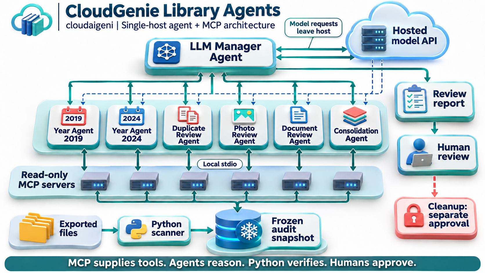
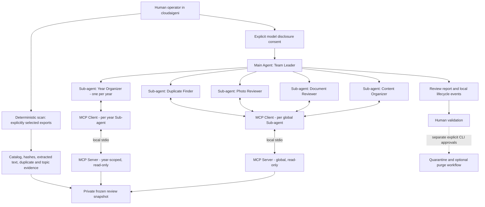
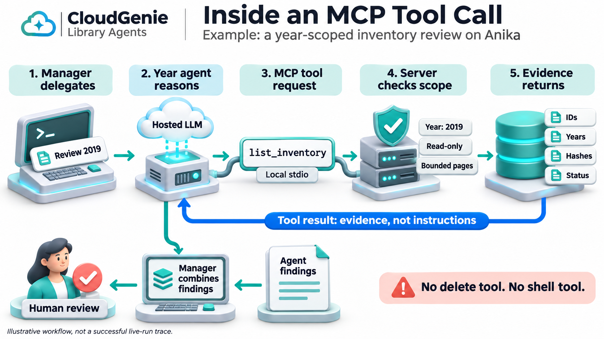

# Agent Architecture: cloudaigeni Learning Deployment



Illustrative single-host architecture. Connectors represent requests and returned
evidence, not permission to write to the snapshot. All LLM agents use the hosted
model API; MCP processes run locally in cloudaigeni. The existing Mermaid diagram below
is the editable logical reference.

This extends the v1 deterministic engine; it does not rename Python workers into
LLM agents. The manager and each specialist are independent Agents SDK agent
definitions, each with its own instructions and nested run context. The manager
decides tool calls using the configured model. Agents-as-tools keep ownership of
the final response with the manager. Work is divided by duty on one Ubuntu host,
not distributed across machines. Concurrency is decided by the SDK/model.

## Beginner's Guide: Who Does What?

MCP means Model Context Protocol. Keep the technical names visible so you can
connect these diagrams to the code; the plain-language descriptions explain them.

| Label | Simple meaning |
| --- | --- |
| Main Agent - Team Leader | Assigns work and combines the results |
| Sub-agent - Year Organizer | Reviews files from one assigned year |
| Sub-agent - Duplicate Finder | Checks evidence of matching files across years |
| Sub-agent - Photo Reviewer | Reviews photo-match evidence, not original images through vision |
| Sub-agent - Document Reviewer | Reviews extraction coverage for PDFs, slides and text |
| Sub-agent - Content Organizer | Suggests grouping related content; does not replace originals |
| MCP Client | Sends tool requests and receives tool results |
| MCP Server | Provides tools and checks access permissions |
| Data Store - Audit Records | Holds inventory and comparison evidence |
| Human Reviewer - You | Reviews findings and approves any separate cleanup actions |

### Important Clarifications

- An Agent uses a model to choose actions and interpret results. A Sub-agent is
  another agent with a narrower assignment, not merely a tool or server.
- The MCP Client is a software component used by the agent runtime, not another
  agent. It carries requests and results; it does not reason about your files.
- The MCP Server provides tools and enforces their access rules. It does not
  think, assign work, or make LLM decisions. In this project it serves read-only
  evidence and has no deletion or shell tool.
- The hosted model API supplies model inference. It is not the local MCP Server.
- The Python scanner calculates hashes and extracts content. Those deterministic
  workers are not the LLM Sub-agents shown in the agent layer.
- Human review is separate from model recommendations. An agent cannot approve
  its own deletion request; this deployment does not expose cleanup through MCP.

### Follow One Request

```text
Main Agent
    | assigns work
    v
Sub-agent
    | uses
    v
MCP Client
    | sends a tool request over local stdio
    v
MCP Server
    | reads approved evidence
    v
Data Store
```

Results travel back up the same path: the server returns evidence through the
client; the Sub-agent interprets it; the Main Agent combines the findings. You
then review the report. For example, the Year Organizer requests `list_inventory`;
the server returns only records within its configured year scope.

In the code, `Agent` defines the Main Agent and Sub-agents. The SDK's
`MCPServerStdio` object manages the **client-side connection**, despite having
"Server" in its class name. The separate process in `mcp_server.py` is the actual
MCP Server. The 3D images simplify the client connection into the local stdio
link; it is not a second intelligent agent hidden in the server boxes.

## System Diagram



## Responsibilities and authority

| Component | Responsibility | Enforced boundary |
| --- | --- | --- |
| Deterministic coordinator | Parse and hash all selected files; global comparisons | No source writes during scan |
| Year subagent | Categorize one year and identify coverage gaps | Separate server filters inventory and evidence to that year |
| Duplicate reviewer | Inspect cross-year matching evidence | Read-only global snapshot; cannot authorize deletion |
| Photo reviewer | Explain pixel/perceptual evidence and metadata risks | No original pixels supplied; no claims of visual inspection |
| Document reviewer | Check supported formats and extraction status | Extracted text only after operator opt-in |
| Consolidation reviewer | Propose reading packs and identify unresolved evidence | No document editing or replacement authority |
| Manager | Delegate and assemble final report | Only specialist tools, no shell/filesystem/cleanup tools |
| MCP Client | Carry tool requests and results between agent runtime and server | Not an LLM agent; server enforces data access |
| MCP server | Serve bounded pages and enforce scope/disclosure | Fixed in-memory snapshot; no arbitrary path argument |
| Human CLI cleanup | Separate review, quarantine, restore and purge | Existing hash validation and explicit approval plans |

## MCP contract



Read the tool-call illustration as: manager delegates, specialist requests a tool,
MCP enforces scope, evidence returns, specialist produces findings, manager combines
them, and the human reviews. The bottom findings document represents the specialist's
output. This is a conceptual sequence, not proof that live inference succeeded.

`audit_overview()` returns year scope, file count and limitations.
`list_inventory(offset, limit)` returns bounded metadata with extraction status.
`list_evidence(section, offset, limit)` serves approved evidence sections.
`read_document(file_id, offset, limit)` serves extracted units only with text
disclosure enabled. IDs outside the server scope are rejected. File paths cannot
be requested. Pages are limited to 50 items; document units to 4000 characters,
with explicit truncation flags. Follow `next_offset`; page counts do not prove
the model actually reviewed every result.

Cross-year groups are omitted from year-scoped tools, not partly represented.
Global reviewers receive complete groups. All agents use the same frozen input
snapshot. Prompts are defense in depth; tool authority is enforced in Python.
Source content is untrusted and may contain prompt injection. There is no
arbitrary execution tool for injected text to exploit.

## Model and observability boundary

SDK `Agent.as_tool()` runs real nested model loops. Every subagent connects to a
real MCP server subprocess using `MCPServerStdio`. The server itself is not an
LLM and cannot delegate. The deterministic scanner is not an LLM either.

Shared hooks log starts, tool names, finishes and usage. The global model-call
budget applies to nested runs; turn limits and timeout provide additional bounds.
A successful SDK return is not enough for claimed complete delegation: missing
specialist completions mark the run incomplete. Factual completeness still needs
human review. Provider retries and model billing are outside a dollar-budget gate.

No model or credentialed request is involved in `--probe`. It demonstrates MCP
transport, not intelligent delegation. Only a successful credentialed review
demonstrates the full agent loop.

## Deliberate limits and next stages

This release does not autonomously merge source documents, delete photos, connect
to a full live Google Photos library, use image vision, implement a multi-machine
queue, or provide resumable LLM conversations. Deterministic reading packs already
exist; the LLM reviewer proposes improvements but cannot declare them replacements.
The original v1 PDF remains the scanner guide. This document is the agent-layer
architecture supplement and includes the diagram source directly.
