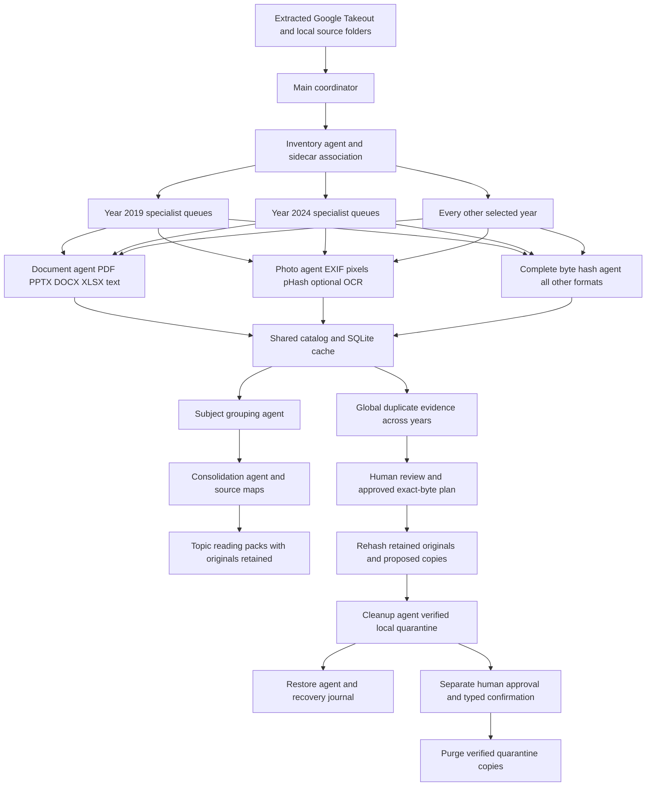
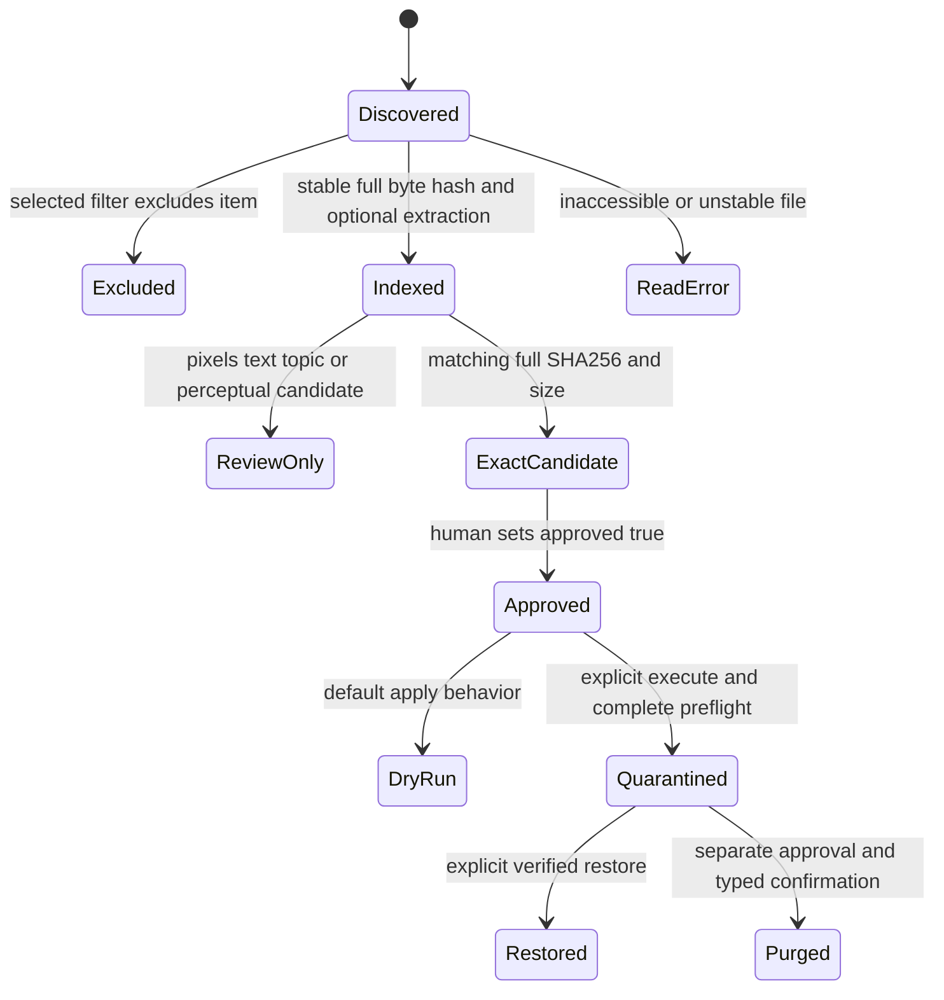
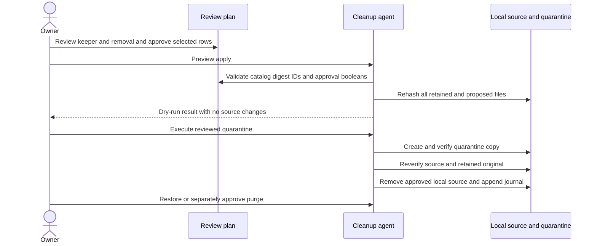

# CloudGenie Library Agents Architecture

## Purpose and boundary

The system converts an exported personal library into an accountable inventory, duplicate evidence and subject reading packs before enabling a reviewed cleanup workflow. It runs as a local Python application. A sandbox or container can host the same program when the operator provides explicit input and output mounts.

The source of truth for analysis is the complete local file, not a thumbnail or filename. The source of truth for cloud identity is metadata supplied by the export, when available. Local byte sizes never establish cloud quota savings. No worker has Google account credentials or cloud deletion methods.

## Component layout

## Agent responsibility and permission contract

| Agent | Input | Output | Permission |
| --- | --- | --- | --- |
| Coordinator | Configured roots and settings | Year/format tasks and run artifacts | Read sources; write run folder |
| Inventory | Filesystem metadata and small JSON sidecars | Canonical paths, IDs, year basis and metadata associations | Read sources |
| Year specialist | Files assigned to one year and modality | Complete hash plus extraction evidence | Read sources only |
| Document | Supported document bytes | Labeled text units, links, completeness status | No execution or macros |
| Photo | Image bytes and EXIF | Dimensions, oriented pixels, pHash, optional OCR | No source edits |
| Duplicate | All selected records across all years | Separate evidence classes | No cleanup tools |
| Subject | Non-empty extracted text | Statistical subject suggestions | No deletion decisions |
| Consolidation | Topic groups and text units | Markdown pack and block source map | Write derived output only |
| Cleanup | Catalog-bound approved plan | Verified quarantine and journal | Local approved files only |
| Restore | Original catalog and verified backup | Restored local files without overwrites | No cloud operations |
| Purge | Separate approved purge plan and confirmation | Permanent removal of validated quarantine copies | Never similarity-only candidates |

DocumentAgent and PhotoAgent are specialized readers invoked by YearAgent. Hash-only work is performed by YearAgent for other file types. ThreadPoolExecutor provides concurrent local execution; workers return data to the coordinator, which serializes SQLite writes. No SQLite connection is shared between worker threads.

## Scheduling and year semantics

Discovery produces canonical file paths and one stable ID per absolute path. Overlapping input roots do not create duplicate path records. The inventory stage indexes recognized Takeout sidecars, then creates a task for each selected `(year, specialist)` pair. Multiple tasks execute up to the configured worker limit. Completion order does not determine report ordering.

Year priority is Takeout `photoTakenTime` in UTC, EXIF capture date, a year inferred from filename/folder, then filesystem modification time in UTC. The final year and basis are preserved per item. Photos with only EXIF dates are classified before a year filter is applied. Year inference does not claim that a download timestamp is the original capture date.

A year worker performs sequential file reads within its queue. This limits simultaneous full-size file loads but means a single large year/modality queue can use only one worker. This implementation is intentionally a local worker pool; moving it to a distributed cluster would require a shared object store, durable task broker, lease/retry protocol and database writer service.

## Pipeline states

File status and extraction status are distinct. `status=indexed` establishes a stable complete hash; the document may still be `unsupported_format`, `missing_dependency`, `truncated`, `needs_ocr_or_empty` or `extraction_error`. Similar-text evidence excludes incomplete extraction. Full-byte comparisons remain available for readable unsupported formats.

## Data contracts

`catalog.json` is versioned and contains `run_id`, `source_roots`, settings, item records, errors and filter exclusions. Item records include `id`, absolute `path`, `category`, `year`, `year_basis`, byte `size`, file `signature`, `sha256`, source metadata, `cloud_url`, and extraction results. A signature contains size, modification nanoseconds, change nanoseconds, device ID and inode ID.

The document result has `status`, `units` with a stable label and extracted text, `urls` and limitation notes. The photo result has decoding status, dimensions, EXIF date, oriented RGBA pixel hash, perceptual hash, optional OCR text and notes. The catalog intentionally contains private material and must be stored like the source library.

`duplicates.json` has separate collections for exact bytes, repeated export representations, equal decoded pixels, equal extracted text and visually similar pairs. Findings reference catalog IDs rather than editable paths. A SHA-256 match is full-file byte evidence; a pHash distance is a review signal with different meaning.

`events.jsonl` records scheduling and year-worker completion. `cache.sqlite3` stores per-file extraction results keyed by path, signature, pipeline version, configuration and associated sidecar data. `status.json` records completed publication. A failed run may leave a running status and a lock; the operator must verify the process has stopped before clearing that lock.

## Exact duplicates and Takeout representations

Hash and size group the entire selected corpus, including cross-year matches. Files recognized as Takeout metadata are not cleanup candidates. If all members of a byte-identical group have the same non-empty Photos URL, the finding is classified as repeated export representation, and generated plans omit it. Multiple albums can reference one original cloud item.

When cloud URLs are missing or differ, exact groups are local byte duplicates only. Their reported redundant bytes are an upper bound for local copies, not confirmed storage savings; hardlinks and cloud quota exemptions can change physical or billed storage. The planner excludes a removal if it and the retained copy share filesystem identity.

## Subject grouping and source provenance

TF-IDF represents extracted text with word and two-word features. MiniBatchKMeans suggests an explicit or automatically chosen number of topics. Terms with high cluster weights label a topic; they are not a validated semantic taxonomy. Subject grouping is global across the selected years.

The consolidation worker emits one current-run reading pack per group. Each distinct normalized text block appears once, with every contributing file ID and page/slide/block reference. A JSON source map stores the same block provenance. Deduplicating a text block in a derived pack does not remove that block or its file from any original document.

Optional Ollama summaries receive an instruction boundary and at most the first 50,000 characters of a pack. They have no tool channel or cleanup capability. A prompt injection inside an original remains untrusted source text. Summary quality still requires human fact checking and cannot authorize cleanup.

## Cleanup transaction sequence

A single operation lock prevents scan and cleanup operations from sharing a run folder concurrently. The entire approved set is preflighted before source changes. Each file then has a prepared event, verified backup, source revalidation and final journal event. Already-created correct backups support reapplication after interruption. The sequence is not atomic across the entire library: a disk failure can leave a completed prefix of operations, with backups and journal evidence.

Paths come from the digest-bound catalog, not arbitrary edited plan fields. Symlink and junction paths, source/run/quarantine nesting, missing keepers, stale hashes, duplicate removal IDs and keeper-removal conflicts are rejected. Permanent purge requires a second approved plan and an exact confirmation string. All destructive behavior is local and opt-in.

## Deployment and optional MCP extension

Windows and WSL use the same Python package. Docker adds a non-root runtime and read-only source mount for analysis. The output directory must be persistent and writable. Cleanup and restore must run in the same path namespace as the catalog; a host cannot directly execute a plan containing container-only `/input` paths.

No MCP server is required or shipped. A future adapter can map configured run IDs to read-only status, summary and review-query tools. Authentication, allowed roots and operator policy belong outside the model. A tool adapter should never expose an unrestricted filesystem path or a permanent-purge endpoint to automatic model calls.

Google Photos API access is limited to app-created media, so MCP is not a substitute for a complete Takeout export. Cloud deletion is a distinct future connector requiring explicit supported capabilities, verified cloud identity, account checks, a review record and appropriate authorization. This package does not implement that connector or browser deletion automation.

## Scaling and release verification

Full hashing is linear in input byte volume. Cache hits reduce repeat extraction. Similar-image matching batches queries and bounds nearest-neighbor outputs, but still has substantial pairwise computation. Subject grouping and extracted content are memory-resident. Default limits are appropriate for a laptop trial, not an unbounded corpus.

Tests cover positive and negative cleanup paths with temporary data, plus cross-year analysis and supported parsers. Real cloud deletion is absent by design. Docker runtime, optional OCR and Ollama require independent environment checks before relying on them. The illustrated guide and source code identify these limits rather than treating missing results as proof that data is absent.
