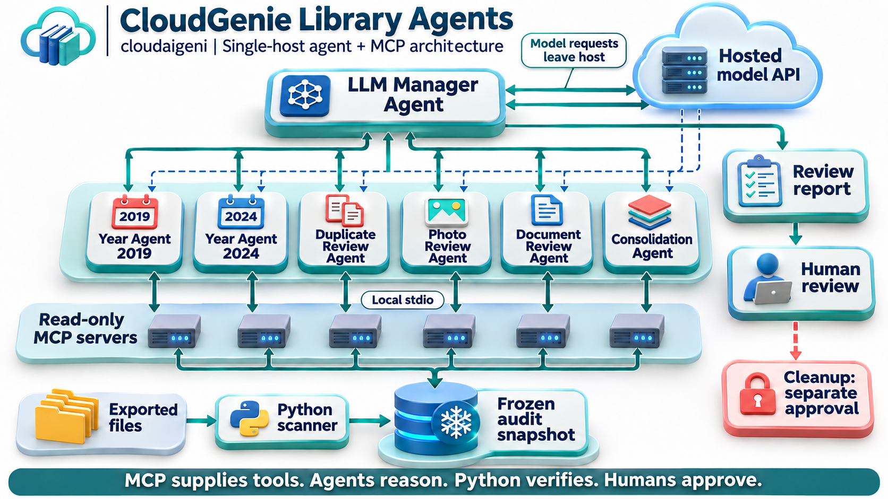
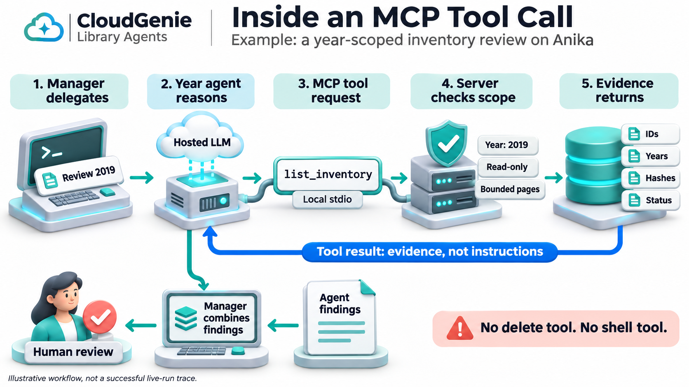

# 3D Design Gallery

These are static, AI-generated 3D-style PNG illustrations, not interactive 3D
models or runtime screenshots. Built-in image generation was used. No API key,
personal library files, or private source material was included in the prompts.
The original v1 PDF has not been rebuilt; these images supplement the Markdown
agent architecture guide.

## How to Read the Labels

**Main Agent** means the team leader; **Sub-agent** means a specialist with an
assigned task. **MCP Client** means the software component that sends tool
requests and receives results. **MCP Server** means the process that provides
tools and checks access. The client is not another agent, and the server does
not reason or make model decisions.

The complete path is **Main Agent -> Sub-agent -> MCP Client -> MCP Server ->
Data Store**. Evidence returns up the same path. In the 3D images, the client is
simplified into the local stdio connection, not drawn as a separate labeled box.
See the [beginner's guide and explicit client/server diagram](../AGENT-ARCHITECTURE.md#beginners-guide-who-does-what)
for the terminology table, examples and code mapping.

## System Overview

1. Python inventories selected exports and computes evidence before LLM review.
2. The manager delegates to year agents and global specialist agents.
3. Each specialist uses a local stdio MCP connection to a read-only snapshot.
4. Hosted model requests leave the cloudaigeni host; MCP itself is not an LLM.
5. The manager produces a review report. Cleanup is a separate human-approved CLI
   workflow, never an available agent tool.

The years 2019 and 2024 are examples from the synthetic demo. Cross-year duplicate
review belongs to the global reviewers, not isolated year agents. The diagram's
two-way connectors depict requests and responses, not snapshot writes.

## Inside a Tool Call

The manager asks for a 2019 review. The year agent chooses `list_inventory`.
Its MCP server enforces the assigned year and pagination limits. Metadata comes
back as evidence. The agent interprets it and returns findings to the manager,
which combines the specialist results for human review.

No delete or shell tool exists in this MCP surface. Text disclosure requires
operator opt-in. The illustration does not depict original-photo vision review.
It does not claim that the API quota issue has been resolved or that a complete
live LLM run has succeeded.

## Generation Prompts

### System overview

Create a polished 3D isometric educational architecture infographic, landscape,
readable large labels, white background, teal/blue/coral accents, physically
rendered miniature computing modules, no robots. Title: 'CloudGenie Library
Agents'. Subtitle: 'cloudaigeni | Single-host agent + MCP architecture'. Clear
top-to-bottom hierarchy with separate, spacious bands and directional arrows.
Top module 'LLM Manager'. Second band SIX separate modules labeled 'Year 2019',
'Year 2024', 'Duplicates', 'Photos', 'Documents', 'Consolidation'. Manager delegates
to all six and receives findings (bidirectional connectors). Third band
'Read-only MCP servers' represented as small server modules, connection label
'Local stdio'. Bottom band a database labeled 'Frozen audit snapshot', and to its
left input folders labeled 'Exported files' flowing into 'Python scanner' then
snapshot. MCP reads snapshot; no arrow or tool allows source modification. Side
module connected to manager output 'Review report' then 'Human review'. Small
isolated locked module 'Cleanup: separate approval' connected ONLY from human
review via dashed line, no agent connection. Add a clear external cloud
above/right 'Hosted model API' connected to manager and specialist band,
annotation 'Model requests leave host'. Footer exact text 'MCP supplies tools.
Agents reason. Python verifies. Humans approve.' These are conceptual 3D images,
not an interactive dashboard. Ensure words precisely spelled and coherent
non-overlapping routes, no fake performance metrics, no Google cloud direct
connection, no suggestion that deletion is enabled. Attractive professional
presentation quality.

### Tool-call walkthrough

Create a high quality 3D isometric educational infographic for CloudGenie Library
Agents. Landscape white background, raised physical computing modules and readable
dark typography, teal blue coral accent palette matching a polished enterprise
architecture presentation. Title 'Inside an MCP Tool Call'. Subtitle 'Example: a
year-scoped inventory review on cloudaigeni'. Five numbered stations with clearly routed
arrows in a spacious left-to-right sequence across the center: '1. Manager
delegates', '2. Year agent reasons', '3. MCP tool request', '4. Server checks scope',
'5. Evidence returns'. Station 1 command console with delegation card 'Review
2019'. Station 2 small computing module with hosted cloud above it labeled
'Hosted LLM', not a robot. Station 3 cable and message block with exact monospace
text 'list_inventory', smaller label 'Local stdio'. Station 4 shield and server
with labels 'Year: 2019', 'Read-only', 'Bounded pages'. Station 5 database with
file cards labeled 'IDs', 'Years', 'Hashes', 'Status'. A distinct blue return route
from station5 back to station2 labeled 'Tool result: evidence, not instructions'.
Then bottom flow from station2 to a report document labeled 'Agent findings' to
station1 'Manager combines findings' to a human approval figure labeled 'Human
review'. Place an isolated caution strip bottom right: 'No delete tool. No shell
tool.' Tiny footer 'Illustrative workflow, not a successful live-run trace.' Do
not suggest tool server calls the LLM or has intelligence of its own. No secrets,
API keys, original photo content or fake metrics. All wording clean and legible
with generous whitespace, no overlapping arrows or words.

## Naming and Agent Label Revision

Both PNGs were edited with built-in image generation, preserving the original
layout and read-only boundaries. Edit prompts: replace the deployment name with
lowercase `cloudaigeni` in both subtitles; in the overview explicitly label the
manager `LLM Manager Agent` and the six specialists `Year Agent 2019`,
`Year Agent 2024`, `Duplicate Review Agent`, `Photo Review Agent`,
`Document Review Agent`, and `Consolidation Agent`. Keep labels legible within
each module. Preserve all remaining content.
